# Diagrammes

Conserver ici les implantations, câblages réversibles et dépendances réseau. Préférer des diagrammes source contrôlables en version.

## Implantation physique de l'appartement — V1

Le Raspberry Pi est le serveur local. Le dongle Zigbee est son coordinateur radio pour les prises, ampoules et capteurs. Les éléments marqués comme optionnels ne sont pas nécessaires au démarrage.

```mermaid
flowchart TB
    INTERNET[(Internet)]

    subgraph SALON["Salon — cœur technique"]
        ROUTER["Routeur Internet<br/>Existant"]
        PI["Raspberry Pi 4<br/>Serveur Home Assistant"]
        SSD["Stockage système<br/>microSD ou SSD USB"]
        BACKUP["Support USB<br/>Sauvegardes"]
        ZIGBEE["Dongle Zigbee USB<br/>Coordinateur radio"]
        POWER["Alimentation<br/>multiprise / parafoudre"]
    end

    subgraph APPART["Appartement — équipements domotiques"]
        subgraph LIVING["Salon"]
            PLUG_SALON["Prise connectée"]
            LIGHT_SALON["Ampoule connectée"]
            TEMP_SALON["Thermomètre + humidité"]
            MOTION_SALON["Détecteur de mouvement<br/>Optionnel"]
        end

        subgraph KITCHEN["Cuisine"]
            PLUG_KITCHEN["Prise connectée"]
            OPEN_KITCHEN["Capteur d’ouverture<br/>Optionnel"]
            LEAK_KITCHEN["Détecteur de fuite<br/>Optionnel"]
        end

        subgraph BEDROOM["Chambre"]
            LIGHT_BEDROOM["Ampoule connectée"]
            TEMP_BEDROOM["Thermomètre + humidité"]
            OPEN_BEDROOM["Capteur d’ouverture<br/>Optionnel"]
        end

        subgraph OFFICE["Bureau / chambre secondaire"]
            MOTION_OFFICE["Détecteur de mouvement<br/>Optionnel"]
            TEMP_OFFICE["Thermomètre + humidité<br/>Optionnel"]
        end

        subgraph BATHROOM["Salle d’eau"]
            LEAK_BATHROOM["Détecteur de fuite<br/>Optionnel"]
            TEMP_BATHROOM["Thermomètre + humidité<br/>Optionnel"]
        end

        subgraph OTHER["Autres pièces"]
            SMOKE["Détecteur de fumée connecté<br/>À vérifier"]
        end
    end

    INTERNET --> ROUTER
    ROUTER -->|Ethernet| PI
    PI --> SSD
    PI --> BACKUP
    PI --> ZIGBEE
    POWER --> ROUTER
    POWER --> PI
    POWER --> BACKUP

    ZIGBEE -. Zigbee .-> PLUG_SALON
    ZIGBEE -. Zigbee .-> LIGHT_SALON
    ZIGBEE -. Zigbee .-> TEMP_SALON
    ZIGBEE -. Zigbee .-> MOTION_SALON
    ZIGBEE -. Zigbee .-> PLUG_KITCHEN
    ZIGBEE -. Zigbee .-> OPEN_KITCHEN
    ZIGBEE -. Zigbee .-> LEAK_KITCHEN
    ZIGBEE -. Zigbee .-> LIGHT_BEDROOM
    ZIGBEE -. Zigbee .-> TEMP_BEDROOM
    ZIGBEE -. Zigbee .-> OPEN_BEDROOM
    ZIGBEE -. Zigbee .-> MOTION_OFFICE
    ZIGBEE -. Zigbee .-> TEMP_OFFICE
    ZIGBEE -. Zigbee .-> LEAK_BATHROOM
    ZIGBEE -. Zigbee .-> TEMP_BATHROOM
    ZIGBEE -. Zigbee .-> SMOKE

    classDef existing fill:#D9EAF7,stroke:#16324F,color:#16324F
    classDef core fill:#E2F0D9,stroke:#375623,color:#375623
    classDef optional fill:#FFF2CC,stroke:#7F6000,color:#7F6000

    class ROUTER,PI existing
    class SSD,BACKUP,ZIGBEE,POWER core
    class MOTION_SALON,OPEN_KITCHEN,LEAK_KITCHEN,OPEN_BEDROOM,MOTION_OFFICE,LEAK_BATHROOM,TEMP_OFFICE,TEMP_BATHROOM,SMOKE optional
```

