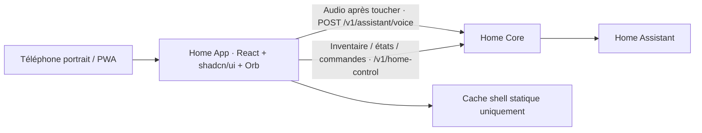

# ADR 001 — App Application, PWA mobile

Décision : demande utilisateur du 6 novembre 2026. Instancier Home App comme SPA installable en portrait, avec la même pile que Home Panel : React, TypeScript, Vite, Tailwind, composants shadcn/ui et thinking-orbs. Alternative native écartée pour cette première version ; une PWA permet une base web commune, avec les limites des navigateurs pour le verrouillage et l’installation iOS.

Accueil : orb tactile pour démarrer/arrêter la capture. Navigation flottante : accueil, domotique, tâches ménagères, rappels. Blocage visuel en paysage ; le manifeste demande le portrait, sans présumer du support du verrouillage système.

Home Core reste la seule frontière API. Réutilisation des contrats voix et domotique existants ; aucune nouvelle API serveur ni nouveau fournisseur. Tâches et rappels : écrans en attente de contrats authentifiés, aucune donnée fictive. Le micro est ouvert uniquement sur action et fermé en quittant l’accueil, en arrière-plan et en paysage. Audio non mis en cache. Session transmise par la même origine, sans nouvelle politique d’identité.

Livraison : frontend statique autonome, Docker prévu avec proxy /v1 vers Home Core. HTTPS requis sur téléphone pour micro et installation. Service worker limité au shell statique ; API toujours réseau, aucune commande différée.

