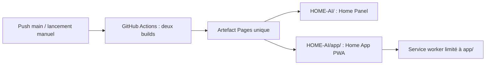

# ADR 002 — Publication GitHub Pages

Demande du 6 novembre 2026 : GitHub Actions et URL distincte pour App Application.

Le workflow existant sur la branche distante main publie Home Panel à `/HOME-AI/`. GitHub Pages ne propose qu’un site par dépôt : deux workflows indépendants écraseraient mutuellement leur publication. Décision : un seul artefact et un seul déploiement, contenant Panel à la racine du site et Home App dans `app/`. Un domaine dédié nécessiterait un autre dépôt/site ou un hébergement supplémentaire ; il n’est pas nécessaire pour avoir une URL distincte.

Les deux builds conservent leurs dépendances isolées. Le préfixe de Home App est configurable ; manifeste, icônes, cache et scope du service worker suivent ce préfixe. Le service worker de l’app ne contrôle pas le panel.

Pages sert uniquement les fichiers statiques, sans proxy vers Home Core. Le déploiement permet de prévisualiser et installer l’interface ; aucune commande réelle n’est annoncée comme disponible. La connexion privée à Home Core reste à définir avant exploitation (HTTPS, identité et accès réseau). Aucun secret Home Core dans GitHub Pages.

