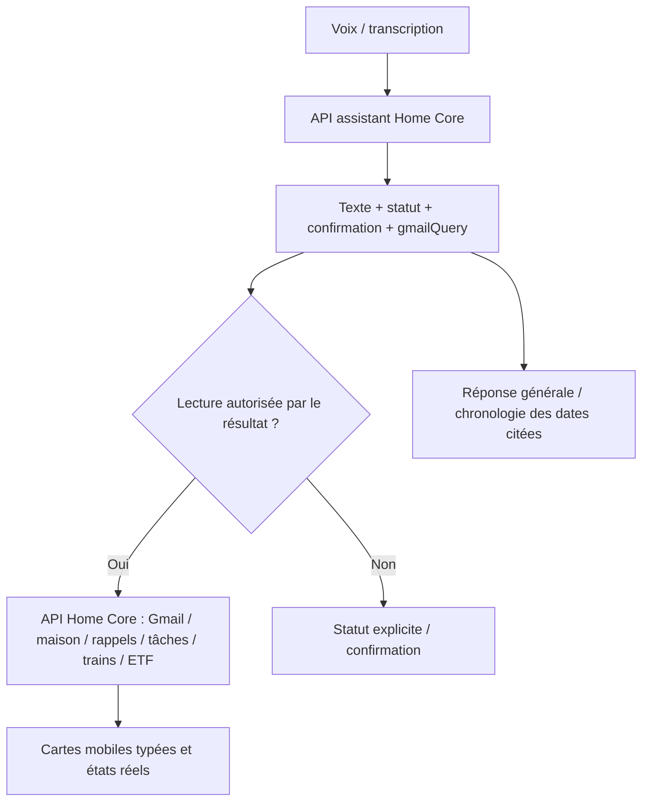

# ADR 003 — Recherche et réponses contextuelles mobiles

Demande du 7 novembre 2026 : réduire l’orb pendant la recherche, afficher la progression et adapter les résultats au contenu.

## Décision

Conserver React/shadcn et thinking-orbs. Réutiliser les primitives Trace du Panel et adapter son carrousel Gmail en composant mobile. Un registre typé de composants (général, biographie, Gmail, domotique, rappels, tâches, trains, ETF) suffit ; pas de nouvelle dépendance à un SDK IA ni de rendu de code/HTML généré par le modèle. Les SDK de generative UI nécessiteraient de nouveaux contrats serveur alors que les sources REST existent déjà.

Le texte de la demande sélectionne un affichage, jamais une autorisation ou une mutation. Préserver le statut, la confirmation et la requête Gmail fournis par Home Core. Les données métier viennent des API existantes après la réponse ; aucune recherche Gmail reconstruite depuis le texte et aucune lecture si la réponse est refusée, indisponible ou attend une confirmation. Confirmation explicite par le contrat `/v1/assistant/questions` déjà existant ; aucune action exécutée sur la simple détection d’un mot.

La progression suit uniquement ce que le client observe : transcription reçue, requête Home Core envoyée, réponse reçue, lecture des sources et affichage. Elle ne présente ni raisonnement interne ni étapes fictives à cadence temporelle. Annuler interrompt les requêtes et l’écoute sans affirmer annuler une action déjà traitée par le serveur. Pas de lecture du statut vocal global, qui mélangerait les sessions.

La réponse générique reste toujours accessible. Une biographie organise les paragraphes datés effectivement contenus dans la réponse ; aucun fait n’est ajouté. Les pièces jointes sont des liens vers Home Core, sans injection de contenu HTML. Les sources éventuelles ne sont affichées que si retournées par le serveur.

Point constaté : `/v1/insights/markets` contient actuellement des cours/variations statiques. N’en reprendre que l’inventaire des ETF configurés (symboles, noms, ISIN), puis utiliser les historiques par symbole pour calculer l’évolution entre les points datés. Ne pas présenter les valeurs statiques ou les actualités de cette route comme des cours en direct. Une série absente produit un état indisponible, sans courbe ou performance de remplacement. Ne pas assimiler les ETF suivis aux positions détenues ou au rendement du portefeuille.

## Flux

## Bibliothèque examinée

[AI Elements](https://github.com/vercel/ai-elements), README consulté le 7 novembre 2026 : composants conversation/message/rendu IA sur shadcn ; la documentation annonce une migration vers shadcn et la dépréciation de ce dépôt fin novembre. Le démarrage documenté suppose Next.js et AI SDK. Ici, la PWA Vite reçoit un résultat REST : conserver ses primitives shadcn/Trace et des cartes métier typées évite une migration de framework qui ne fournirait pas les données manquantes. Une intégration ultérieure d’AI Elements reste possible avec un contrat de streaming par requête.
