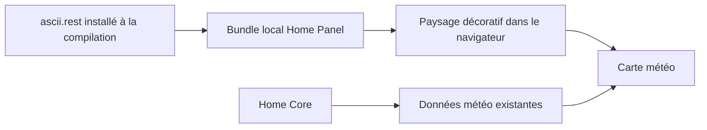

# ADR — Paysage ASCII du composant météo

Statut : accepté à la demande utilisateur, 2026-11-04.

## Décision

Utiliser `ascii.rest` (0.4.0, MIT) et son composant React `Ascii` avec la
pièce `landscape`, importée explicitement et incluse dans le bundle du Panel.
Le paysage décoratif montre montagnes et lac avec soleil ou lune selon
l’heure locale du navigateur. Il ne représente pas les conditions météo réelles.

## Conséquences

Aucun appel à ascii.rest depuis le navigateur : le décor reste disponible
sans service tiers. Les données météo continuent de passer par Home Core.
L’animation est limitée à 8 images par seconde et respecte la préférence
de mouvement réduit via la bibliothèque. Un masque laisse les informations
lisibles ; le décor est ignoré par les lecteurs d’écran et les interactions.
Le dégradé existant reste le fond de repli.

## Alternatives

Un script distant ajouterait une dépendance réseau à l’affichage. Un dessin
ASCII maison ne répondrait pas au choix explicite d’ascii.rest.

Documentation : https://ascii.rest/docs/react/ et https://ascii.rest/landscape/.
